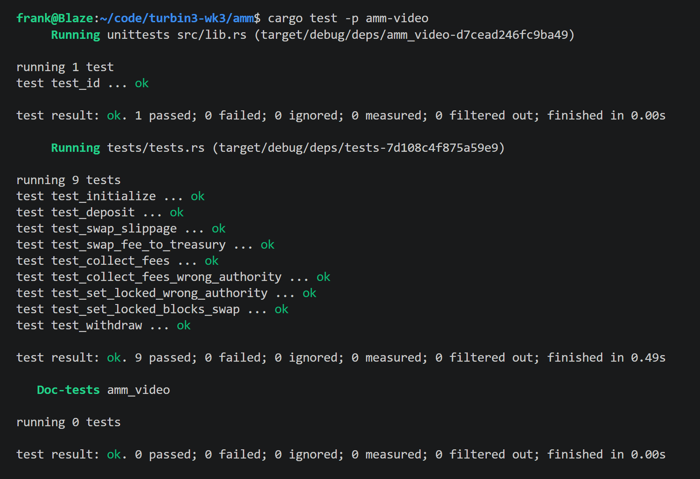

# Turbin3 Week 3: Constant-Product AMM with Protocol Fee

Anchor program implementing a constant-product (x·y=k) AMM, extended with a
protocol fee paid into a program-owned treasury. Forked from the class repo
(ShrinathNR/amm_q2_26).

Program ID: `9mSvCYwR1iS9FRBob7goHMNF7LqPKJLpWk4fu8iko6nS`

## Instructions

| Instruction | What it does |
|---|---|
| `initialize` | Creates the pool Config PDA, LP mint, two vaults, and two treasury token accounts. Sets the LP fee (`fee`), the protocol fee (`treasury_fee`), and an optional authority. |
| `deposit` | Adds X and Y in proportion to the reserves and mints LP tokens. `max_x` / `max_y` protect against slippage. |
| `withdraw` | Burns LP tokens and returns a proportional share of X and Y. `min_x` / `min_y` protect against slippage. |
| `swap` | Takes the protocol fee off the input and sends it to the treasury, then swaps the rest on the curve (which applies the LP fee). `min_amount_out` protects against slippage. |
| `collect_fees` | Authority only. Moves all treasury balances to the authority's token accounts. |
| `set_locked` | Authority only. Locks or unlocks the pool. Deposit, withdraw and swap fail while locked. |

## Fee design

A swap carries two separate fees:

- **LP fee** (`fee`, e.g. 30 bps): stays in the vaults, so each LP token claims a larger share of the pool. This is how liquidity providers earn.
- **Protocol fee** (`treasury_fee`, e.g. 20 bps): taken from the input before the swap and sent to a treasury token account outside the pool reserves, so it never counts as LP liquidity.

Treasury accounts are PDAs (`["treasury", config, mint]`) owned by the Config PDA,
so only the program can move funds out, and only through `collect_fees`, which
requires `config.authority` to sign. If a pool is created with no authority,
its protocol fees can never be collected.

## Tests

Rust integration tests using LiteSVM (`programs/amm-video/tests/`).

| Test | Proves |
|---|---|
| test_initialize | Pool, vaults and treasury accounts are created |
| test_deposit | First deposit sets the ratio and mints LP |
| test_withdraw | Burning LP returns proportional X and Y |
| test_swap_fee_to_treasury | A 10-token swap at 20 bps puts exactly 20,000 base units in the treasury |
| test_swap_slippage | An impossible `min_amount_out` fails with SlippageExceeded, and no fee is kept |
| test_collect_fees | Authority receives the full treasury balance; treasury goes to 0 |
| test_collect_fees_wrong_authority | A non-authority is rejected with InvalidAuthority |
| test_set_locked_blocks_swap | Locking blocks swaps (PoolLocked); unlocking restores them |
| test_set_locked_wrong_authority | A non-authority cannot lock the pool |

## Run it

    anchor build
    cargo test -p amm-video

Tests load `target/deploy/amm_video.so`, so build before testing.

## Changes from the class code

- Protocol fee and treasury accounts; new `collect_fees` and `set_locked` instructions
- Lock check added to swap
- Fixed LP math precision in deposit and withdraw: the curve library's `precision` argument is a scaling multiplier, not a decimal count. The class code passed `6`, which truncated the LP ratio to whole sixths (e.g. depositing for 10 LP into a 200 X / 100 LP pool cost 0 X, and withdrawing 10 LP paid 33.3 X instead of 20). Changed to `1_000_000` in both instructions.